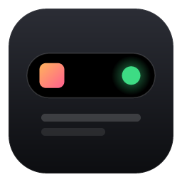
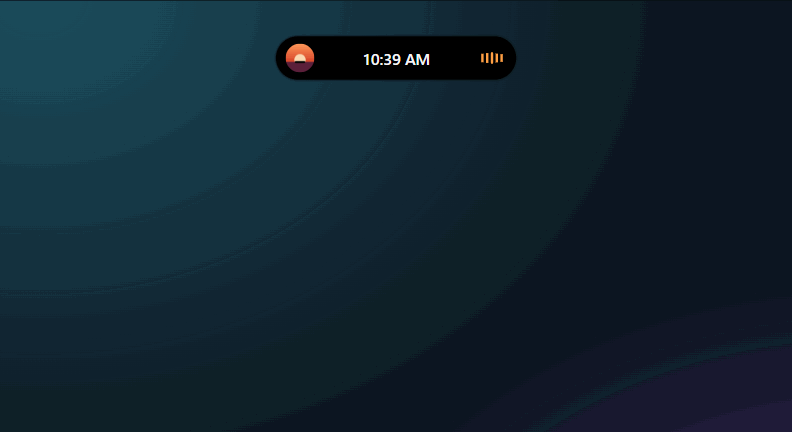
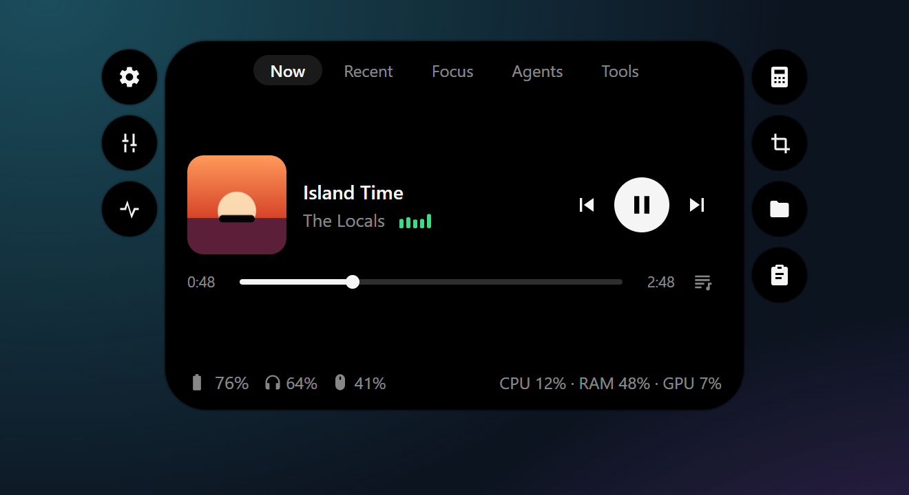
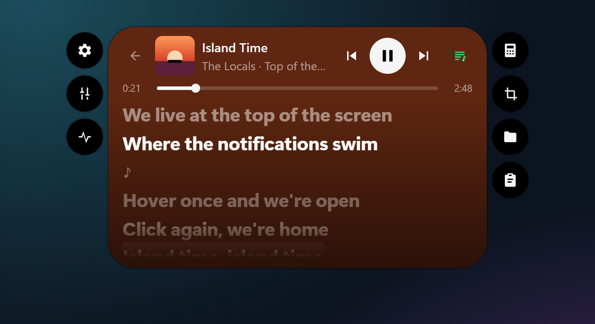
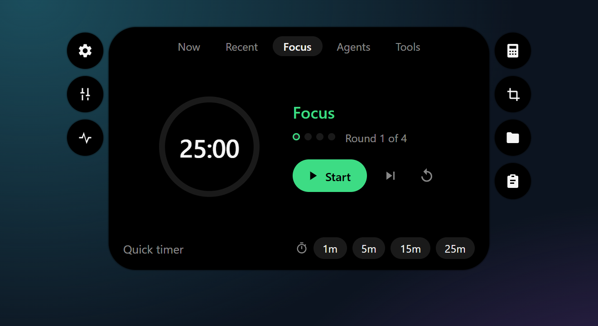
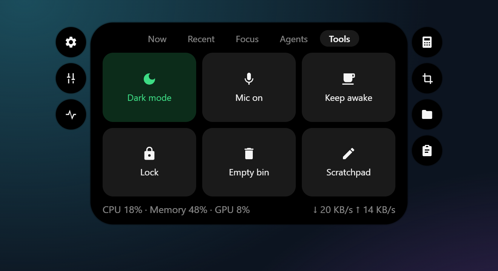

<div align="center">



# Pulo

**A Dynamic Island for Windows.**

A small pill at the top of your screen that shows what's happening: the song that's playing, your next meeting, a finished download, a running focus timer. Hover to peek, click to open.

[](https://github.com/PatriusCastro/Pulo/releases)
[](#install)
[](LICENSE)

[**Download**](https://github.com/PatriusCastro/Pulo/releases) · [**Try it in your browser**](https://patriuscastro.github.io/Pulo/) · [Build from source](#build-from-source)



</div>

## Small until you need it

It stays out of the way and grows only as far as you ask.

| Rest | Peek (hover) |
|---|---|
|  |  |

| Open (click) | Synced lyrics |
|---|---|
|  |  |

| Focus timer | Quick tools |
|---|---|
|  |  |

<sub>Captured from the [live demo](https://patriuscastro.github.io/Pulo/), so the songs and lyrics are made up.</sub>

Built with [Tauri 2](https://tauri.app) (Rust) and React. It's light: no looping animations, and background work runs only for the features you turn on.

## Features

| | |
|---|---|
| **Now playing** | Title, artist and art from any app that reports to Windows media controls (Spotify, browsers, Apple Music, …). A live waveform shows in the pill while music plays. |
| **Music page** | Seek, previous/play/next, shuffle, repeat and speaker volume. |
| **Synced lyrics** | Big lines in the style of Apple Music and Spotify, on a background tinted by the album cover. Click a line to jump to it. Lyrics come from [lrclib.net](https://lrclib.net). |
| **Focus timer** | Pomodoro rounds with a progress ring and adjustable lengths. |
| **Calendar** | Your next event, plus a heads-up 15 minutes before. Works with any iCal link (Google, Outlook, …). |
| **Downloads** | A notice when a download finishes. Open it later from the Recent tab. |
| **Notifications** | New Windows notifications appear in the island (MSIX build only). |
| **Device batteries** | Bluetooth mouse, keyboard and headphones. |
| **AI agents** | Follows [Claude Code](https://claude.com/claude-code) sessions and tells you when a long task finishes. |
| **Quick tools** | Dark mode, mic mute, keep awake, lock, Recycle Bin, system stats. |
| **Shortcuts** | Up to 5 buttons on each side of the open island (Calculator, Screenshot, Task Manager, …). |
| **Pet** | A little sprout that naps when you're away. |

Every feature can be turned off in **Settings**. Press **Ctrl+Alt+Space** to open and close the island from the keyboard.

## Install

Download the installer from [Releases](https://github.com/PatriusCastro/Pulo/releases) and run it. Pulo checks for new versions, and the tray menu offers to install one when it's out. Until the first release is published, [build it from source](#build-from-source).

Requirements: Windows 10 (version 2004 or newer) or Windows 11, with WebView2, which Windows 11 already includes.

## Privacy

Pulo runs on your PC. It contacts the internet only for:

- **Lyrics:** sends the song's title, artist and length to lrclib.net. Turn this off under Settings → Now playing.
- **Calendar:** fetches the iCal link you paste, every 10 minutes.
- **Updates:** checks GitHub releases for a new version.

Settings are saved in `%APPDATA%\com.pulo.dev\settings.json`. The AI agents feature only reads local Claude Code logs in `%USERPROFILE%\.claude\projects`, and nothing from them leaves your PC.

## Build from source

You need [Node.js](https://nodejs.org) 22+, [Rust](https://rustup.rs) (stable) and the [Tauri prerequisites for Windows](https://tauri.app/start/prerequisites/).

```sh
npm install
npm start          # run in development with hot reload
npm run check      # unit checks for the calendar, lyrics and pomodoro logic
npm run exe        # release build: src-pulo/target/release/pulo.exe
```

See [CONTRIBUTING.md](CONTRIBUTING.md) for the project layout, the MSIX dev build and how releases work.

## Contributing

Bug reports, ideas and pull requests are welcome. Please read [CONTRIBUTING.md](CONTRIBUTING.md) first.

## License

[MIT](LICENSE)
